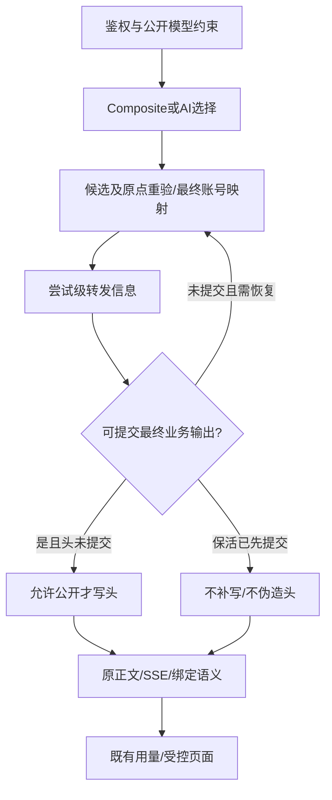

# v0.2.21-barry.4 转发信息与 AI 路由产品设计

2026-11-11 · 用户已授权实施和 fork 发布，Taom 切换待确认。当前实施采用 D2 退路，响应头默认关闭，历史用量继续由管理员诊断。实施与验证见 [tasks.md](tasks.md)。

## 一、推荐的产品边界

建议 `.4` 先交付“用户能核对路由结果”的最小闭环，而非扩大自动决策能力。

| 阶段 | 用户得到什么 | 不据此宣称什么 |
| --- | --- | --- |
| `.4` 可观察性 | 用量页区分请求别名和已记录转发模型；原始 HTTP 工具可读取即时提示 | 供应商实际执行身份已证明，客户端日志自动改变，AI 已省钱 |
| 后续 AI 试点，另行授权 | 独立 Key、小候选池、配置可理解、可对比固定基线 | 可以替代个人主链路或审计判断 |
| 有证据后扩展 | 按本项目样本选择普通决策器或 Jev，确定适用任务 | 默认需要双决策器、评分门控或更多权限 |

现有计划明确个人主会话及审计仍用 Composite。以下用户场景由现有工作流推导，是设计假设；本轮未做用户访谈或真实选模效果实验。成功不是“用户启用了 AI”，而是用户能解释一次请求、在确有收益的任务上安全使用它。

产品要依次回答：我请求了什么？网关实际发出了什么？为什么这样选择？相比固定配置有没有更好？最后一个问题必须用任务质量、总费用和端到端耗时回答，不能用路由 HTTP 成功率替代。

## 二、用户任务及使用流程

### 固定 Composite 的日常使用

继续使用原 Key、模型别名和工具。管理员明确开启可见性后，在现有“使用记录”查看请求模型与转发模型；缺失显示“未记录”。用户无需理解候选 ID 或修改系统提示。curl/支持 raw response 的 SDK 可即时读头，但网页是主要人工查询入口，不要求客户端集成才能获得产品价值。

### 管理员核对“选 A，为何发给 B”

先查已记录的发送模型，再从现有管理用量和 AI 诊断核对候选、策略版本、账号映射、上游自报模型及失败阶段。候选、自报、发送模型不同不直接判定错误，例如对方可能返回版本化名称。普通用户只看受控转发信息，不展示内部目标、提示词或整个候选池。

### 独立 AI 试点

沿用分组管理的“路由”入口及现有三个模块，不另建 AI 平台。

| 步骤 | 用户操作与结果 | 必须防止的误解 |
| --- | --- | --- |
| 建停用草稿 | 先定一个用途，如整理或检索；主链路继续 Composite | 创建组不等于生效 |
| 配候选池 | 引用已授权账号/普通组，描述适用任务与限制 | 候选数量不代表效果；单个合格候选无需付费决策 |
| 配决策器 | 普通模型或 Jev 单选，填写简短偏好 | 决策器不是执行模型，不可越权 |
| 确认上下文 | 明确选择元信息或许可的有界可见历史，查看实际外发预览 | 元信息不足以识别所有任务；有界历史不等于全部上下文 |
| 检查配置 | 显示候选排除原因、能力限制和外发范围，不调用模型 | 检查配置不伪造“AI 已选对” |
| 试跑决策 | 单独点击后才外发，只看选模，不执行任务 | 试跑不是无成本，也不证明执行模型完成任务 |
| 发布试用 | 明确发布策略，用独立 Key，先选一个支持入口 | 保存草稿不发布；已有五入口不等于必须同时开放 |
| 比较及退出 | 对比固定基线；不合适则恢复试点客户端原 Composite 配置 | 停用 AI 组会拒绝其 Key，不会自动转换成静态组 |

这是后续使用说明/评估建议，`.4` 不借此新增模板、自动影子执行或重做配置 UI。

整理/检索试点只使用经许可内容；检索还依赖现有客户端工具和候选能力，路由器本身不提供检索工具。角色、主/子代理身份、项目风险及SOP并非网关天然知道，不能让模型凭空猜到它们。

不建议 AI 路由：用户已明确指定模型/审计职责；候选没有实际差异；授权、价格或可用性不可靠；不允许任务内容发给决策方；只有元信息却期待精细语义判断。工具、签名、缓存及 Responses 原点要求固定来源时，绑定优先于重新选择。

## 三、源码核查与改造入口

官方基线固定在 `v0.2.21@10ba8f9b4dc2e6023d4a9879ab77b21841babd10`，fork 核查点为 `54f38c4de`（上次发布提交 `dda005953`），共同基线为 `v0.2.20@dab829a4e`。临时仓库的 `git merge-tree` 预检发现六处文本冲突。下表分开记录两侧源码事实和后续合并要求。路径相对仓库根。 [官方版本差异](https://github.com/Wei-Shaw/sub2api/compare/v0.2.20...v0.2.21)

| 位置 | 已核实事实 | 对任务的影响 |
| --- | --- | --- |
| `backend/internal/service/openai_gateway_responses_anthropic_native.go`，responsesResp.Model = originalModel | 响应保留公开别名 | 不改正文，另提供观测信息 |
| `backend/internal/service/ops_upstream_context.go` | 已有 SetOpsUpstreamModel/ClearOpsUpstreamModel，发送前设置、换尝试清理 | 优先复用，但需证明每分支覆盖；Ops 值不自动等于成功 |
| `backend/internal/service/gateway_service.go`，ForwardResult；`openai_gateway_usage.go`、`gateway_usage_billing.go` | 请求、发送、自报模型已有分离；Forward 返回时响应可能已发完 | 不能在 Forward 返回后补头 |
| `backend/internal/service/openai_gateway_response_handling.go`，`keepaliveCh` | `stageFirstOutput` 可先写 SSE 注释并 Flush。OpenAI handler 的 `openAIForwardMayFailover` 另有心跳字节校正和 `SafeToFailoverAfterWrite` 条件 | 分开判定 HTTP 头已发和当前分支还能否恢复。保留现有恢复条件 |
| `backend/internal/handler/gateway_helper.go`，AcquireUserSlotWithWait | 并发等待可先发 ping | 路由确定前也可能提交头 |
| `backend/internal/handler/ai_routing.go`，prepareAIRoutingExecution | 选候选、重验、原点绑定后仍进入实际账号映射 | execution_model 不是最终模型的通用替代 |
| `backend/internal/service/ai_routing_trace.go` | 有 request/client/usage ID、策略版本、选择来源和估算决策费用 | 复用诊断，不新增平行日志；三种 ID 不强行视为同一值 |
| `backend/internal/handler/dto/mappers.go`、`types.go`、`mappers_usage_test.go` | 普通投影明确隐藏 upstream_model 等，并有测试保护 | 新字段是信息边界变更，不删旧安全断言换绿灯 |
| `frontend/src/views/user/UsageView.vue`、共享 UsageTable | 用户页共用组件但只收到用户 DTO | 共用组件不等于上游字段已对用户开放 |
| `backend/internal/server/middleware/cors.go` | expose 列表没有拟新增头和 X-Request-ID | 合并原项目列表，不放宽 Origin 或凭据边界 |

### 三个 HTTP 出口

| 出口与入口 | 流式提交与故障转移 | 最终模型与记录 | 合并后验收 |
| --- | --- | --- | --- |
| `/v1/messages`，`GatewayHandler.Messages` / `OpenAIGatewayHandler.Messages` | handler 对比转发前后 writer 大小。OpenAI→Messages 在 `openai_gateway_messages.go` 处理首个 Anthropic 事件，定时 `ping` 可先提交并标记已输出。原生 Anthropic、Bedrock、Gemini 和 Antigravity 各有适配器 | `gateway_forward.go` 的 `mappedModel`、`openai_gateway_messages.go` 的 `upstreamModel` 和 Gemini URL 模型需与实际请求逐分支对照。Antigravity 兼容返回值来自 `call.billingModel`（构造时为映射值），需对照请求封装后的实际 ID | 测原生及跨协议流、首个协议帧前过载、`ping` 后错误、工具签名及思考恢复。保留新版合成 reasoning effort 校验和 fork 的转换规则 |
| `POST /v1/responses`，`OpenAIGatewayHandler.Responses` / `GatewayHandler.Responses` | 官方原生与 passthrough 的首输出分类把 `codex.rate_limits`、`codex.response.metadata` 作为前导元数据。首输出前过载可返回 failover，前导留在本次尝试。网关定时保活仍可先提交 HTTP 头。Anthropic 转换路径新版会先应用账号错误策略再决定是否切换 | 原生、passthrough、`openai_gateway_responses_chat_fallback.go` 及 Anthropic 转换均需核对最终发送与结果。重试前清除旧尝试，分别核对 B 的发送、输出和落账。共享转发代码的显式 compact fallback 也更新 Ops 模型，但独立 compact 端点在本期范围外 | 复用官方元数据后过载用例，追加 A→B、早保活后恢复、显式账号错误策略、工具参数及原点绑定。分别覆盖原生、passthrough、Anthropic 和 Grok/Chat 桥接 |
| `/v1/chat/completions`，`OpenAIGatewayHandler.ChatCompletions` / `GatewayHandler.ChatCompletions` | `openai_gateway_chat_completions.go` 桥接流可发 SSE 注释。`cc_pipeline` 首 token 判断会排除 usage-only chunk；原生 raw Chat、Anthropic 转换、Gemini 和 Antigravity 走各自流式写出。handler 依各自已写出检查决定换账号 | Responses→Chat 及原生 raw Chat 均设置 Ops 最终模型并在结果中返回 `UpstreamModel`。Anthropic 与 Gemini 转换各有结果字段，需用请求体或 URL 证明；Antigravity 同上 | 用角色前导、纯用量块、工具增量、`[DONE]`、拒绝和早保活逐项核对提交与终态。Anthropic 路径覆盖新版账号错误策略，Gemini 非流覆盖思考摘要从正文剔除 |

Responses 的官方测试在正常和 passthrough 两个路径上断言元数据后过载返回 `UpstreamFailoverError`，且响应体尚未写出。此结论适用于该测试入口，三出口仍各自保留现有协议和恢复判断。 [官方修复及测试](https://github.com/Wei-Shaw/sub2api/commit/e401c58053ce79b68985d1bd47aed49477baaf48) · [Anthropic 兼容错误策略](https://github.com/Wei-Shaw/sub2api/commit/090c58f663a8e745b0e564518cafe7557e6f92e2)

三类入口要复核 fork 路由链 `Key/分组白名单 → AI 识别 → Composite 目标解析 → 平台 handler` 及实际路由别名。工具 writer (`aiToolWriter`、`aiChatFrameGate`) 可能缓存帧并包装 `Written`、`Size`、`Flush`。观测点以底层真实提交和适配器确认的输出为准，同时保留绑定 writer 的 finish、取消、错误和原点约束。T1 在整合树上把每条可达分支归入“可确认写头 / 省略 / 范围外”。

### fork 定制兼容性

| 保护项 | 核查结果与验收要求 |
| --- | --- |
| 合并冲突 | 六处为 `backend/cmd/server/VERSION`、`backend/internal/pkg/apicompat/anthropic_to_responses.go`、`backend/internal/service/apicompat_config.go`、`gateway_scheduling.go`、`openai_gateway_count_tokens.go`、`openai_gateway_messages.go`。逐处合并语义。版本对齐 `v0.2.21-barry.4`；转换、调度、count_tokens、Messages 同时保住 fork 行为和官方修复 |
| Composite 显式目标 | 保留目标组/账号、公开别名、候选可用性、并发限制、Key 权限、映射与故障转移。用目标与默认池不同的样例，检查真正发往指定目标、不可用时仍按既有策略处理，不能误入默认池 |
| AI 路由和绑定 | 五入口的既有覆盖应回归，三个 HTTP 入口提供本期头。Responses WS 和 Gemini 原生继续按原合同，尤其验证 WS 续轮失败后的 1013/重连边界、Responses 工具原点、单候选直达、合格兜底和后台禁用。Jev 权限与已有配置原样兼容 |
| 跨厂商请求转换 | 用现有隔离 TLS/合成上游用例保护思考、签名、工具续轮和模型重映射。对照新版 Responses 函数参数、reasoning effort 校验、Gemini 非流思考剔除和 Antigravity 工具结果、配额冷却。核对启用头前后业务输出相同 |
| Gemini 测试模型 | 官方两个标签间测试目录、账号测试服务及两个测试弹窗相关文件一致。保留 fork `38683314d` 的 Google One 目录和 `gemini-3.8-flash` 默认，验证两处 UI 与测试请求使用同一模型 ID。账号真实可用性仍需独立实测 |
| 用量、价卡与配置 | `openai_gateway_usage.go`、用量 DTO 和持久化有共同修改。保留 30m/12h 入库、默认/显式价卡、普通用户与管理员的原权限，以及 fork 的路由计费主体、去重和预留判断。以整合后的官方计费行为作开关对照。核对部署配置有无显式 `gateway.request_body_memory_budget_bytes`，按容器限制评估自动值，涉及配置变更时单独记录 |
| 发布与更新渠道 | 保留 fork 更新检查、GHCR 发布及不可变 digest 验证。整合后重新比对冲突以外的共享文件和生成文件，跑已有 fork 检查 |

## 四、数据合同与可见性（推荐，待确认）

| 概念 | 含义 | 本期处理 |
| --- | --- | --- |
| 请求模型 | 客户端别名，用户既有 model 语义 | 保持原样 |
| AI 候选模型 | chosen.Model / execution_model，可能继续映射 | 既有管理员诊断，不直接当头 |
| 转发模型 | 最终载荷/目标 URL 实际发送的模型 ID | 拟公开的唯一新增模型信息 |
| 上游自报模型 | 上游返回 model，可能版本化或缺失 | 既有管理员字段，不当成真实性证明 |
| 计费模型 | 当前账本规则实际使用的模型 | 不因显示功能改变 |

UI 建议统一叫“转发模型”，说明“网关发往上游的模型标识”，避免用“实际模型”暗示已证明供应商内部执行身份。配置平台类型也不证明兼容接口背后的真实厂商。

### 可见性

建议一个管理员设置“向调用者显示转发模型”，默认关闭；拟使用 expose_upstream_model 键，复用 SettingService、通用 settings 表及缓存，不新增 schema。统一控制 HTTP 头和普通用户新字段。关闭或读取异常时不返回新增信息，但不阻断正常生成。

设置入口建议放在现有“系统设置”页面新增一项，不另建导航。经既有 PublicSettings / app bootstrap 仅提供无敏感信息的布尔能力标志，供用户页决定是否显示列，不从某一行有无值反推开关。后端投影始终是权限依据；旧前端缓存即使仍显示列，关闭后的新查询也不能返回值，刷新后隐藏。已收到的数据不能承诺远程抹除。

普通用户仍只查自己的记录，不复用 AdminUsageLog。既有默认 UsageLogFromService 的信息范围保持，新增受控投影不借机删除或扩展其他既有字段。不得新增目标组/账号/地址/完整映射链披露。已有管理诊断不因开关关闭而受限。已发出的头不可撤回；配置生效遵循现有设置缓存及失效机制，不承诺跨进程即时撤销。

### HTTP 头

| 字段 | 语义 |
| --- | --- |
| X-Sub2API-Upstream-Model | 确认的最终发送模型；建议最多256字节、可打印 ASCII、禁控制字符；超限或不能安全表达时省略，不截断冒充另一个模型 |
| X-Sub2API-Route | 固定模式/配置平台，例如 composite/openai、ai/anthropic；不含组、账号、候选或 URL |
| X-Request-ID | 沿用现有 HTTP 诊断 ID，不新增一套，不默认等于用量账本 request_id |

前两个头成组输出，不允许/不可信时一起省略；只取网关可信元数据，不能透传入站或上游伪造的同名头。不开调用者请求头来绕过管理员开关。该命名空间保留给网关；三类出口即使未命中路由或关闭功能，也不透传伪造的同名值，不影响其他业务头。

适用：三类生成出口已匹配的 Composite/AI 路由。未命中路由的普通调用、count_tokens、compact、retrieve/delete/input_items、后台、独立媒体、WS、Gemini 原生不扩展。非 ASCII 自定义名仍正常生成，只不保证头展示。

### 用户用量字段（后续）

本次发布沿用管理员用量诊断。下文保留后续普通用户列的字段契约及来源约束。

建议独立可选字段 `forwarded_model`。返回条件为开关开启、调用者拥有记录、能证明记录属于本期三出口的已匹配路由，且持久化 `UpstreamModel` 有可靠的最终发送语义。两类 `RecordUsage` 从各自 ForwardResult 取 `UpstreamModel`，`UpstreamResponseModel` 独立记录。空值、截断或语义不明的记录显示“未记录”。

当前用量有分组、协议入口和映射信息，但没有覆盖所有 Composite / AI 路径的持久化“本次匹配模式”字段。当前组配置、非空 `UpstreamModel` 或模型别名无法单独证明历史请求命中。T2 必须验证可复用的关联及所有者隔离。若现有数据只能证明部分记录，明确覆盖范围；若无法支持可用的网页范围，提交选择：本期先交付头及沿用管理员诊断，或另行确认网页可见范围或持久化变更。默认为来源不明的行省略字段。

即时头来自最终发送；页面来自事后记录。两者都有时必须相同。无字段、延迟落账、请求无用量行不是同一情况，不笼统说成失败。当前合同不增加账本关联列，也不改主键；X-Request-ID 与账本关联须沿现有分支验证，不能直接承诺“一键按该ID查到账单”。

## 五、提交时序与失败语义

推荐正确性优先、允许缺头，不改变既有保活与恢复。

| 情况 | 行为 |
| --- | --- |
| 鉴权失败、无候选、决策失败无合格兜底 | 无新增头，保持原错误 |
| 成功非流正文已取得，最终模型可确认，头未提交 | 写两头后返回原正文 |
| 流式最终输出尝试可确认，头未提交 | 在当前适配器既有合法输出点写头。Responses 元数据分类、Messages 事件和 Chat chunk 各用现有判断，保留提交顺序 |
| 排队 ping / 等待保活先提交 | 不写猜测值；请求可能成功但无模型头 |
| 尝试 A 输出前失败，分支允许恢复到 B | 清理 A。B 确认输出且还能写头时写 B；早保活已提交时依旧可以按原规则恢复，页面只取已记录的 B |
| 已有头后报错、断流或取消 | 不能撤回；头只说明已公开的转发尝试，不保证最终成功；不追加假成功 |
| 上游成功但用量异步写入失败 | 头不等于已落账；沿用既有记账告警，不生成替代账单 |
| 续轮/缓存/Responses原点绑定 | 沿用绑定，不因观测再决策或换来源 |

原稿“失败请求无头”应改为：提交前被拒或没有可信转发输出时不写；提交后失败可能已经有头。

### 实现策略及备选

推荐复用请求内 Ops/路由归属和账本语义，适配器在最终映射、重验和实际发送/输出确认时更新尝试级信息，在首次合法提交点写入。必须清理旧尝试，不用全局“上次模型”缓存。跨 goroutine 写入需有明确同步，不新增每次写入查库。

保留 Gin Write、WriteString、WriteHeader、WriteHeaderNow、Flush、状态、取消等契约；验证与 AI 绑定 writer 的嵌套顺序。复用已有语义输出闸门，不再建一套 SSE JSON 解析器。不确认的分支省略元数据并仅留非敏感诊断。

不采用：Forward 返回后再设头（常已发完）；直接用候选（可能继续映射）；延迟全部 ping（改变等待/断流行为）。本期也不以 HTTP trailer、额外 SSE 事件、改正文补结果，这些另需客户端契约。

## 六、页面及客户端兼容性

普通用户列属于后续设计。本版通过原始 HTTP 读取头，通过管理员用量页查询已记录数据。开关在请求准入时读取，已在途请求沿用准入值。部分 Gemini 和 Antigravity 流式及状态桥接路径在没有可信提交点时省略头。

用户页沿用现有表格、列偏好、分页、过滤、主题和窄屏布局。model key、原排序/过滤仍指请求模型。开关开启时增加默认可见“转发模型”列，新列暂不提供服务端排序/筛选；未知显示“未记录”。长名截断但可读取/复制完整值，使用文本转义。

共享 UsageTable 必须显式区分用户新列与管理员原模型映射单元格，防止关闭功能后残留对象泄露管理字段。既有 CSV 格式和模型分布图保持不变，说明网页新列暂不进入导出，不暗示已有真实厂商成本统计。

| 客户端/中间层 | 能承诺的范围 | 未决验证 |
| --- | --- | --- |
| curl/raw HTTP | 满足提交条件时可读头 | 实际代理是否保留 |
| Anthropic SDK | 官方有 raw/streaming response 头访问接口 | 实际 SDK 版本；常规 Message 不等于自动存自定义头 |
| 浏览器 fetch | 需 Expose-Headers 才能跨域读取 | 合并既有 ETag/Server-Timing/WWW-Authenticate；不放宽 Origin/凭据规则 |
| Claude Code/Desktop | 原 API 正文/SSE 仍兼容 | 没有证据证明自动写入本项目自定义头到 /tasks 或会话日志；Desktop托管模式另验 |
| CC Switch/反向代理 | 不依赖专门适配 | 逐跳验证，不以“通常透传”作为验收 |

客户端消费是开工前的产品门槛：先核对用户实际客户端/代理版本和可用读取入口。如果目标只是“网页可核对”，本设计可独立交付；如果唯一目标是“/tasks或本机统计自动变更”，当前范围不足，应先确认客户端集成路径，不能开发完网关后才发现没人消费。

HTTP 头不是系统提示，模型不会因此知道真实厂商。若用户真正需要本机自动统计，须在证明客户端消费方式后另立集成任务；不能以“服务端返回了头”宣布本机统计已解决。

## 七、AI 路由与 Jev 的产品取舍

| 决定 | 推荐 | 原因 |
| --- | --- | --- |
| 主链路 | 保留 Composite 精确别名 | 明确的模型/审计职责无需多一层不确定性 |
| Jev参与方式 | 与普通模型二选一，先比较 | 并行复核增加费用/延迟/冲突规则，暂无本项目收益证据 |
| 参与程度 | 只从合格候选中选一项 | 不调 effort、工具、输出预算，不越过权限 |
| 数据上下文 | 元信息保留；语义判断需显式允许的有界可见历史 | 系统提示、工具原文、附件、隐藏思考不自动外发；正则脱敏不等于消除所有机密 |
| 置信度 | 后续研究信号，不默认阈值0.55 | 分布集中程度不同于本项目任务成功率，受候选及任务分布影响 |
| 试点 | 独立Key、一个HTTP入口、低风险文本任务 | 支持五入口不等于同时扩大试用；续轮先保原点 |
| 四档别名/任务头降级 | 单独规划 | 控制变量，别把固定映射、透明度、语义路由混为一次发布 |

当前源码有 bounded_history 投影和分段诊断，但真实语义效果未评测。NewAIRoutingDraft 当前默认 bounded_history、15000ms，不能把历史稿的“默认仅元信息、3秒”当作当前事实。本方案不擅改默认值；后续 UX 要明确查看并确认外发范围，已发布策略不自动扩大。

### 可解释性

复用 trace 的公开模型、策略版本、候选、选择来源、耗时、用量、估算费用和执行关联。single、continuation、fallback 分别解释成“唯一候选直达、续轮沿用、合格固定兜底”，不都称“AI判断”。trace在选择阶段产生，不把“已选中”写成“任务成功”。用户看受控结果，管理员看诊断。

不为显得聪明而生成长理由或保存内部思考。优先使用人工可编辑的候选用途、确定性排除原因及选择来源；自然语言解释若要做，需另评费用、泄露和真实性。

### 效果评估与退出

以下为拟采用的方法，不是已测收益或统计门槛：

- 样本分整理/检索、审查、相同末句不同历史、模糊任务、工具续轮、缺价/失效候选；用户先定义可接受结果、固定基线与允许选择集合。
- 每类可先约20个样本用于发现流程问题，数量是试验起点建议，不是统计充分性证明。调规则与最终评价样本分离，历史变体按任务分组避免泄漏。
- 比较固定 Composite、单普通决策器、单 Jev。先离线检查；真实调用、数据外发与样本留存另获授权，不自动影子执行生产请求。
- 报告任务通过/拒绝数、严重错误、端到端耗时、决策次数、续轮、失败重试、缓存变化和未知费用；不只看选中便宜模型的比例。
- 总费用 = 执行费用 + 决策费用 + 失败/重试费用 + 必要回退重做费用。长历史多阶段决策全部计入；目录估算与实际支付分开，未知保持未知。
- 净节省 = 固定基线总费用 - 路由总费用。质量容忍差与延迟上限由用户结合样本确认，不编造“省30%”或默认可降质比例。
- 越权、数据外发越界、原点错绑立即停止试点；质量/延迟不达约定则恢复试点客户端固定配置。没有明显收益也允许长期保留 Composite。

### 可用性验收，不只测API

后续获准进行用户试用时，先让实际使用者完成下列任务，观察能否独立操作和解释，记录求助点、耗时及误解；当前未进行此测试，不虚构访谈或评分。

1. 从一条使用记录找到请求与转发模型，说明“未记录”为什么不等于与请求相同。
2. 区分决策模型、候选执行模型和最终发送模型；能说明试跑只选模、不会替自己执行任务。
3. 识别“唯一候选/续轮/兜底”并非又一次AI决策；没有决策费用不等于总请求免费。
4. 在点击试跑前找到外发内容和范围，知道有界可见历史不含工具原文/附件/隐藏思考，也不保证彻底去密。
5. 停止试点并恢复原Composite配置，理解关AI组不会自动转换原Key。

若把“选中”等同于“执行成功”、把候选名当作最终发出模型、无法找到退出操作，应先修正文案/交互，不扩到主链路。由维护者本人先试能发现问题，但不能据此宣称所有用户都能理解。

合成示例（非实际请求）：请求模型 `public-daily`；来源“唯一候选直达”；转发模型 `model-b`；执行结果“失败”。页面必须允许用户理解：本次没有付费选模不代表执行免费，且已有转发信息不代表任务完成。供应商自报版本仍属管理员诊断。

## 八、公开调研证据及适用边界

2026-11-08 查阅第一方或原始资料：

- [Claude Code网关兼容指南](https://code.claude.com/docs/en/llm-gateway-protocol)说明保活的重要性，及gateway hint headers的版本、显式开启条件；custom base URL下提示头默认关闭。因此不假定 Desktop 或代理流量必带 request-class，也不将可伪造客户端头作为授权依据。本期不消费它改路由。
- [Anthropic SDK](https://platform.claude.com/docs/en/api/sdks/python)和[官方迁移说明](https://github.com/anthropics/anthropic-sdk-python/blob/main/MIGRATION.md)支持显式读原始头，不证明各客户端自动保存。
- [CC Switch公开源码](https://github.com/farion1231/cc-switch/blob/main/src-tauri/src/proxy/response_processor.rs)的普通流/非流处理复制非hop-by-hop响应头，提供了“普通透传可能保留这些头”的源码依据；不证明转换路径或本机版本一致，也不证明其用量统计会消费这些字段。
- [MDN Expose-Headers](https://developer.mozilla.org/en-US/docs/Web/HTTP/Reference/Headers/Access-Control-Expose-Headers)给出浏览器额外头的读取条件，不授权扩大跨域来源。
- [TypeSafe Choice](https://docs.typesafe.ai/primitives/choice)适于有限候选；[Confidence](https://docs.typesafe.ai/confidence)说明分布形状与领域校准问题，不能据此证明本项目固定阈值有效。
- [RouteLLM原论文](https://arxiv.org/abs/2406.18665)研究用偏好数据权衡质量费用，支持做本项目对照；其模型、样本与收益不能直接移用为本fork承诺。

本轮未访谈用户、抓取会话、读取生产请求、访问服务器或调用模型；真实客户端兼容和效果评估均未进行。

## 九、验证、发布与恢复

先在整合后的 `v0.2.21` 基线上验证 fork 功能，再叠加响应头和用量页，用同一模拟上游对比开关态。证据包含捕获的最终请求体或 URL 模型、响应提交及事件顺序、尝试与失败阶段、已存用量字段和计费结果。首次可写头与用量落账分别验收。完整用例见 [tasks.md](tasks.md)。

### 自动迁移及升级条件

| 官方迁移 | 源码行为 | 需验证的结果 |
| --- | --- | --- |
| `249_add_usage_logs_api_key_cost_index_notx.sql` | 非事务 `CREATE INDEX CONCURRENTLY`，索引 `idx_usage_logs_api_key_created_cost` 覆盖 Key、时间及 `actual_cost`。可能受大表、长事务、I/O 和磁盘空间影响。迁移器对尚未记账的该迁移可清理无效索引并重建 | 迁移记录 checksum、`pg_index` 有效性、Key 费用查询、实际耗时及磁盘增长。模拟中断，分别覆盖未建、无效索引、有效索引但迁移未记账和已完成 |
| `250_openai_cache_write_ttl.sql` | 事务内为 `usage_logs` 增加 30m/12h 两列，默认 0。渠道价卡、价格区间、账号统计价卡和对应区间各增可空 12h 价格列 | 迁移记录及列的默认/可空定义，保留旧记录金额及通用价卡。验证新字段读写、计费、聚合和旧 `.3` 在该库的读写 |

迁移器按完整文件名记录及比对 checksum。旧 `249_mcp_oauth.sql` 与新 `249_add_usage_logs_api_key_cost_index_notx.sql` 名称不同；fork 的三项 `fork_00x_*.sql` 保持原文件和内容。静态预检在 fork 源码数到 303 个 SQL 文件，预检合并树为 305 个。Taom 2026-11-07 的 `.3` 历史记录为 303 项，部署前须重新核对实际清单、checksum 和索引/列状态。只在基线吻合时按两项新增、共 305 项验收。 [249 索引迁移](https://github.com/Wei-Shaw/sub2api/blob/v0.2.21/backend/migrations/249_add_usage_logs_api_key_cost_index_notx.sql) · [250 TTL 迁移](https://github.com/Wei-Shaw/sub2api/blob/v0.2.21/backend/migrations/250_openai_cache_write_ttl.sql) · [迁移执行器](https://github.com/Wei-Shaw/sub2api/blob/v0.2.21/backend/internal/repository/migrations_runner.go) · [Taom 上次部署记录](../../../artifacts/release-v0.2.20-barry.3/deployment-result.json)

先用现有迁移守卫和隔离 PostgreSQL 回放 `.3 → .4`、官方 `v0.2.21 → fork`、全新安装和重复启动，再用备份恢复的隔离库演练 `.3 → .4 → .3`。回退演练包含 249 中途失败、249 完成而 250 未完成、两项均完成，以及 `.4` 已产生合成用量和 12h 价卡的情况。旧版启动后要读历史行、写新用量、检查 Key/余额/订阅、Composite/AI 组和三入口生成。旧版源码没有 30m/12h 分项写入和 12h 价卡读取。回滚保留已入账费用，新请求恢复旧版计费语义。升级窗口建议沿用现有价卡，确认旧版回滚后的计费差异可接受再启用新价卡。网页还要验证新前端遇到旧后端缺少能力标志时隐藏新列，以及旧前端忽略新字段。

### Taom 切换与回滚条件

隔离 PostgreSQL 18.6 已回放三种安装基线并重复迁移。备份恢复后的演练覆盖两项未执行、249 中断留下无效索引、有效索引尚未记账和仅完成 249，均可推进到 305 项并保留原 303 项 checksum。旧 `.3` 镜像可读取已迁移的历史和 TTL 用量，并通过模拟上游写新用量。样本为合成小库。Taom 启动前须核对应用迁移时限与实际表体量。初次安装路径默认 60 秒，已初始化应用的迁移上下文上限为 10 分钟。

部署获授权后，先确认旧 `.3` 与新 `.4` 镜像的不可变 digest、Compose 配置、当前迁移及数据库版本、代理网络和磁盘空间。旧服务运行期间预拉新镜像、备份 PostgreSQL 及部署配置并核对完整性，实际恢复到隔离库验证可用。根据隔离回放的迁移耗时和生产表体量设定等待预算。监测启动日志、`pg_stat_progress_create_index` 和锁等待，在有进度时按预算等待，区分应用尚未就绪与迁移已失败。

切换使用经审查的一条 detached 后台任务，包含仅重建应用、恢复代理网络、本机/公网健康和运行身份检查、迁移状态检查、业务验证、失败回滚及持久日志。切换前说明现有 SSE 可能断开；旧镜像、配置和备份持续可用。复用 [Taom 部署约定](../../../artifacts/PROJECT_LOCATION.md) 和 [fork 维护规则](../../../FORK_MAINTENANCE.md)，按新迁移重新审查旧脚本的计时和校验条件。

| 触发条件 | 恢复步骤与验收 |
| --- | --- |
| 备份、拉取或基线核对失败 | 保持旧应用运行，记录失败并核对旧入口、代理与健康 |
| 仅响应头或页面信息错误 | 关闭可见性，核对后续头和用户字段消失，并检查生成与计费。记录已公开范围，已发送数据无法撤回 |
| 新应用、网络、生成、计费或迁移失败，数据库状态属于已验证的回退分支 | 隔离新流量并停止新应用，确认迁移连接和建索引状态。恢复旧 Compose 配置和 `.3` digest，仅重建应用，恢复代理。保留数据库、迁移记录和已入账用量，核对旧版本身份、本机/公网健康、三入口、权限和账本。旧版兼容条件未通过时暂停生产切换 |
| 迁移状态未知、回滚后旧版也无法安全读写，或发现数据损坏 | 停止写入，保留故障库及日志，查明事务和新增写入范围。先恢复备份到独立库并验证，再决定受控切库。明确备份时点至停止写入间的用量、余额、订阅及配置差异和可接受的数据丢失窗口。DB 恢复按单独批准的方案执行；自动回滚只负责应用与代理 |

中断 249 时，以数据库进度、`indisvalid` 和迁移记录判断状态。已验证可重启 `.4` 的情况由原迁移器处理，先确认没有另一个仍在运行的任务。保留原迁移文件和 checksum；禁止用手工补迁移记录、盲目删索引/列或覆盖生产库来通过检查。恢复完成以业务和账本验收为准，单独的 `/health` 只证明服务响应。

## 十、已审查的取舍

| 编号 | 推荐 | 备选与代价 |
| --- | --- | --- |
| D1 | `.4`只做可观察性，AI先设计试点 | 同时改算法需扩范围与评估 |
| D2 | 一个管理员默认关闭开关，用户字段只展示能确认属于本期路由的自有记录 | 若缺可靠来源，先交付头和管理员诊断，或单独确认扩大网页范围或新增持久化凭据 |
| D3 | 条件允许才写头，提前提交允许缺失 | 保证所有流都有最终信息需另选trailer/事件/延迟，兼容成本更高 |
| D4 | Route只给模式/平台 | 按原稿给组名/ID会泄露内部资源结构 |
| D5 | Composite主链路，独立Key试点，单决策器只选候选 | 直接接主链路或增加复核/置信度权限需先给效果与恢复证据 |

本轮按推荐实施并采用 D2 的预设退路。独立 Key 试点及 Taom 切换待用户后续决定。
